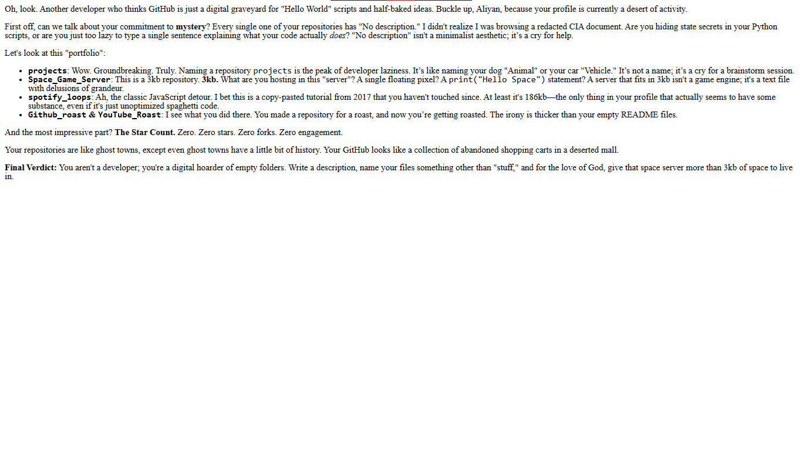

# GitHub Roast

A web app that logs you in with GitHub, reads your repositories, and asks Gemini to write a funny roast about your coding habits: abandoned projects, missing descriptions, zero stars, and bad naming.

**Live demo:** https://github-roast-m4ts.onrender.com

> **Note:** The free host sleeps when idle, so the first load can take up to a minute.



## How it works

1. The user clicks **Login**. The app uses OAuth 2.0 (authorization code flow) with the `read:user`, `user:email` and `repo` scopes.
2. After login, the server exchanges the temporary code for an access token and keeps it in a signed session cookie.
3. GitHub's OAuth is plain OAuth 2.0 (no OpenID Connect), so there is no `userinfo` in the token. The server calls the GitHub REST API (`GET /user`) to get the profile. If the email is private, it falls back to `GET /user/emails` and picks the primary one.
4. On **Roast**, the server calls `GET /user/repos` and keeps only the useful fields: name, stars, description, language, last push date, forks, size, fork status and topics.
5. That data is sent to Gemini with a roasting prompt. If a model fails, the app tries the next one in a fallback list.
6. The result is converted from Markdown to HTML and shown on a styled page.

## Tech

- Python, FastAPI, Uvicorn
- Authlib (GitHub OAuth), httpx
- Google Gemini API (`google-genai`) with model fallback
- Deployed on Render

## Run it locally

1. Create a GitHub OAuth App at **Settings → Developer settings → OAuth Apps**. Set the callback URL to `http://localhost:8000/callback`.
2. Get a Gemini API key from Google AI Studio.
3. Create a `.env` file (the names must match the ones used in `main.py`):

```
Github_client_id=...
Github_secret=...
github_roast_cookie=a-long-random-string
GEMINI_API_KEY=...
```

4. Install and run:

```
pip install -r requirements.txt
uvicorn main:app --port 8000
```

5. Open `http://localhost:8000` (use `localhost`, not `127.0.0.1`, or the login cookie won't match).

For a deployed copy, also set `BASE_URL` to your public address with no trailing slash (for example `https://your-app.onrender.com`), and add `<BASE_URL>/callback` as another redirect URI in your GitHub OAuth App. The start command on Render is `uvicorn main:app --host 0.0.0.0 --port $PORT`.

## What I learned

- How OAuth 2.0 works: client ID and secret, the redirect URI, the authorization code, and why the code is exchanged on the server.
- The difference between plain OAuth and OpenID Connect: Google gives you `userinfo`, GitHub makes you call its API.
- How to read API docs: find the endpoint (`GET /user/emails`), the scope it needs, and the shape of the response.
- Why `token=token` is how Authlib sends the `Authorization: Bearer ...` header.
- Private emails come back as `null`, and `.get()` returns `None` silently for a misspelled key, so print the raw response before trusting your code.
- Why user-controlled text must be escaped before it goes into HTML (XSS).
- Keeping secrets out of git with `.gitignore`, and setting them as environment variables on the host.

## Known limitations

- The roast is based on repository metadata only (names, stats, dates). It never reads the code inside the repos.
- The access token is stored in a signed (not encrypted) cookie, so it is readable by the user's browser.
- No data is saved on the server. The free Gemini quota is shared, so heavy use can run out.

## Ideas for next steps

- Read each repo's README or commit history for sharper jokes.
- Store tokens server-side instead of in the cookie.
- A "gentle mode" option for a softer roast.